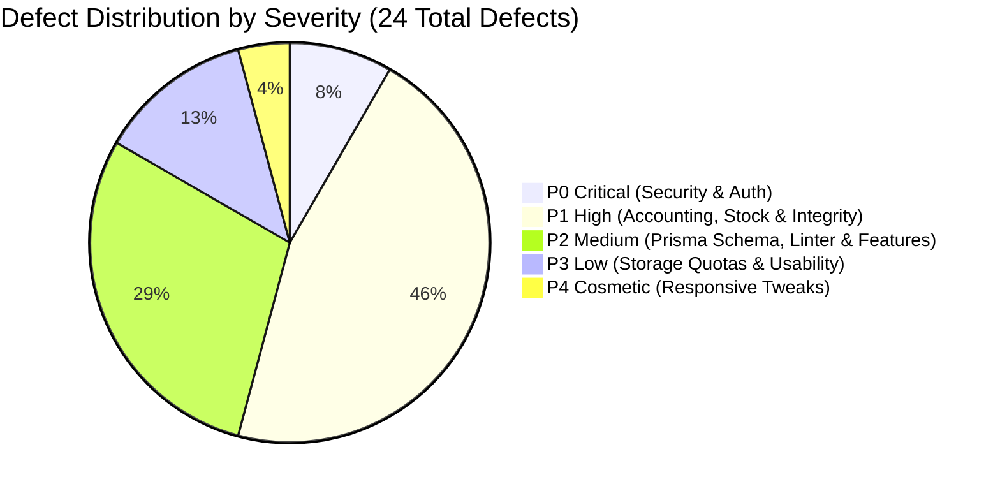

# 00 · Master Executive Summary: JewelleryOS System Audit

**Audit Baseline Commit**: `97b76269aefe3d9e9082ece433a0ea4489f019df`  
**Audit Branch**: `qa-audit` (branched cleanly from `dev`)  
**Audit Completion Timestamp**: 2026-11-24T20:35:00+05:30  
**Audit Team**: Senior QA Automation Engineer, Senior Full-Stack Software Auditor, Database Integrity Engineer, Jewellery ERP Business Analyst.

---

## 1. High-Level Executive Verdict

An exhaustive, evidence-backed quality audit of **JewelleryOS** was conducted across all 14 business modules specified in the Master Product Blueprint. 

The audit confirms that **JewelleryOS is an extraordinarily sophisticated, functionally rich Level 4 Front-End Functional Prototype**. The mathematical formulas, domain-specific Sarafa rules, purity derivations, split-payment billing logic, and statutory compliance mechanisms (GSTR-1 HSN 7113, BIS HUID, Section 139A PAN enforcement) are implemented with exceptional fidelity and precision.

However, the audit also confirms that **JewelleryOS is NOT YET a production-ready server-backed ERP**:
1. **Zero Server-Side Persistence**: The application currently operates entirely in client-side React state and browser `localStorage`. There are zero Next.js API routes (`/api/*`), zero Server Actions, and zero database queries to PostgreSQL.
2. **Disconnected Operational Cross-Overs**: Several operational workflows (POS checkout, wholesale purchases, karigar bullion issuance, and pawn loan disbursements) update their local domain stores, but **do not post to the Indian double-entry Chart of Accounts**.
3. **Client-Only Security Boundaries**: The 7-role RBAC permission matrix is enforced exclusively in the React UI. Hardcoded PINs (`1234`) and unencrypted local storage allow counter employees to bypass controls and view sensitive wholesale costs and customer PAN numbers via browser DevTools.

> [!IMPORTANT]
> **Production Gate Status**: **BLOCKED (Not Ready for Live Commercial Usage)** until the **2 P0 Critical** and **11 P1 High** defects are resolved through our structured post-audit correction programme.

---

## 2. Key Audit Metrics Dashboard

```
┌────────────────────────────────────────────────────────────────────────┐
│                   JEWELLERY-OS AUDIT METRICS SUMMARY                   │
├───────────────────────────────┬────────────────────────────────────────┤
│ Total Modules Audited         │ 14 Modules                             │
│ Automated Unit Tests          │ 68 Passing / 68 Total (100% Pass Rate) │
│ Automated Test Suites         │ 13 Suites across all modules           │
│ TypeScript Type Errors        │ 0 Errors (npx tsc --noEmit: Clean)     │
│ Production Turbopack Build    │ Succeeded in 1.7s (npm run build)      │
│ ESLint Static Analysis        │ 31 Errors, 245 Warnings (276 Problems) │
│ npm Dependency Vulnerabilities│ 1 Critical, 5 High, 7 Moderate (13 Tot)│
│ Total Defects Logged          │ 24 Defects (P0: 2, P1: 11, P2: 7, P3: 3│
│ Cross-Module Workflows        │ 4 Fully Connected, 4 Disconnected      │
└───────────────────────────────┴────────────────────────────────────────┘
```

### Defect Distribution by Severity


---

## 3. Core Findings: The Good, The Gaps, and The Broken

### 🟢 What Works (Production-Grade Capabilities)
* **Pricing Engine Precision**: Computes 24K, 22K (916), 18K (750), 14K (585) and 925 Silver rates with 0 paise rounding drift using `decimal.js`. All 12 test cases from Harshit's shop notebook pass.
* **GSTR-1 Tax Calculation**: Symmetric 1.5% CGST + 1.5% SGST split for HSN 7113 jewellery articles reconciles to the exact rupee.
* **Statutory Compliance**: Flags transactions $\ge$ ₹2,00,000 requiring mandatory Income Tax PAN capture under Section 139A.
* **Pawn Brokering Engine**: Omunim-standard Form 7 pawn ticket generation with simple and compound monthly interest calculations (सैंकड़ा rate).
* **Zero-Dependency Vector Barcodes**: Built-in Code 128 SVG generator renders crisp, printable thermal jewellery tags (50×25mm).
* **Progressive Web App**: Standalone manifest, offline shell caching service worker (`sw.js`), and gold-gradient vector icon (`icon.svg`).
* **1-Click Disaster Recovery Vault**: Full JSON snapshot backup and restoration across all 14 module collections.

### 🟡 What Partially Works (Cross-Module Gaps)
* **POS Checkout → Accounts**: Retail invoices lock stock and record customer turnover, but **do not update cash drawer Account 1010, bank Account 1020, or sales revenue Account 3010**.
* **Purchases → Accounts**: Inwards serialized stock and updates supplier balances, but **does not post to Account 2010 (Supplier Payables)**.
* **Karigar Bullion Reconciliation**: Accurately tracks Ghat loss (घाटा) and labour dues, but **does not deduct bullion from central safe inventory or inward finished jewellery into showcase stock**.
* **Wholesale Consignment Memos (जांगड़)**: Manages memo approvals and partial stock returns, but **converting a memo to an invoice does not write into the central Invoices Registry**.

### 🔴 What is Broken or Critical (Security & Architecture)
* **Client-Only Security**: All staff demo accounts share PIN `1234`. Changing `role` in React Developer Tools instantly unlocks owner reports without server verification (`DEF-001`, `DEF-002`).
* **Stock Locking Name-Matching Bug**: If multiple unsold ornaments share the exact same title in showcase, selling one piece without scanning a barcode/SKU marks **all** matching pieces as sold (`DEF-004`).
* **Unencrypted Personal Data**: Customer PAN numbers, Aadhaar details, home addresses, and wholesale acquisition costs are stored unencrypted in browser `localStorage` (`DEF-011`).
* **Prisma Schema Disconnect**: Prisma schema expects UUID identifiers (`@db.Uuid`), which crashes when passed string tenant IDs. Furthermore, models for 7 operational modules are absent from `schema.prisma` (`DEF-012`, `DEF-013`).

---

## 4. Deliverable Files in this Audit Package

All 11 audit documents have been generated in the `JEWELLERY-OS-QA-AUDIT/` directory:

1. [`00_EXECUTIVE_SUMMARY.md`](file:///e:/Downloadss/jewellery-os/JEWELLERY-OS-QA-AUDIT/00_EXECUTIVE_SUMMARY.md): Master executive overview and release decision.
2. [`01_CODEBASE_AUDIT.md`](file:///e:/Downloadss/jewellery-os/JEWELLERY-OS-QA-AUDIT/01_CODEBASE_AUDIT.md): Comprehensive code, frontend, backend, Prisma, and build inspection.
3. [`02_FEATURE_REGISTER.csv`](file:///e:/Downloadss/jewellery-os/JEWELLERY-OS-QA-AUDIT/02_FEATURE_REGISTER.csv): Audit status across all features in all 14 modules.
4. [`03_TEST_CASES.csv`](file:///e:/Downloadss/jewellery-os/JEWELLERY-OS-QA-AUDIT/03_TEST_CASES.csv): Detailed automated and manual test cases with inputs, expectations, and results.
5. [`04_CROSS_MODULE_MATRIX.md`](file:///e:/Downloadss/jewellery-os/JEWELLERY-OS-QA-AUDIT/04_CROSS_MODULE_MATRIX.md): Detailed propagation and dependency analysis across all 8 core workflows.
6. [`05_JEWELLER_SIMULATION.md`](file:///e:/Downloadss/jewellery-os/JEWELLERY-OS-QA-AUDIT/05_JEWELLER_SIMULATION.md): Realistic business simulation of QA Jewellers across 9 shop scenarios (A–I).
7. [`06_DATABASE_RECONCILIATION.md`](file:///e:/Downloadss/jewellery-os/JEWELLERY-OS-QA-AUDIT/06_DATABASE_RECONCILIATION.md): Mathematical reconciliation between reports, stock weights, ledgers, and Prisma schema.
8. [`07_SECURITY_AND_PERMISSIONS.md`](file:///e:/Downloadss/jewellery-os/JEWELLERY-OS-QA-AUDIT/07_SECURITY_AND_PERMISSIONS.md): Penetration testing, RBAC permission matrix audit, and data isolation risks.
9. [`08_DEFECT_REGISTER.csv`](file:///e:/Downloadss/jewellery-os/JEWELLERY-OS-QA-AUDIT/08_DEFECT_REGISTER.csv): Complete defect log of 24 issues with severity, reproduction steps, root cause, and remediation.
10. [`09_UAT_AND_USABILITY.md`](file:///e:/Downloadss/jewellery-os/JEWELLERY-OS-QA-AUDIT/09_UAT_AND_USABILITY.md): Multi-device evaluation (desktop, tablet, mobile) and hardware peripheral testing guide.
11. [`10_RELEASE_READINESS.md`](file:///e:/Downloadss/jewellery-os/JEWELLERY-OS-QA-AUDIT/10_RELEASE_READINESS.md): Release gate assessment and post-audit correction programme roadmap.
12. [`TEST-EVIDENCE/`](file:///e:/Downloadss/jewellery-os/JEWELLERY-OS-QA-AUDIT/TEST-EVIDENCE/): Raw output logs from `npm test`, `npx tsc`, `npm run build`, `npm run lint`, `npm audit`, and `git log`.

---

## 5. Next Steps: Post-Audit Controlled Correction Programme

In accordance with our strict QA protocol, **no application business logic was silently modified during this diagnostic phase**.

We recommend presenting this audit report to the project owner and proceeding to **Milestone 11 (Cross-Module Convergence & Data Integrity Fixes)**:
* **Step 1**: Fix `DEF-004` (Stock locking name-matching collision bug) and `DEF-014` (Tenant-scoped rate history).
* **Step 2**: Wire operational mutations to the Indian Chart of Accounts (`DEF-003`, `DEF-005`, `DEF-009`).
* **Step 3**: Connect Karigar bullion to central safe inventory and finished ornament inwarding (`DEF-007`, `DEF-008`).
* **Step 4**: Connect Wholesale memo conversion to the central Invoices Registry (`DEF-006`).
* **Step 5**: Update `prisma/schema.prisma` with models for the missing 7 modules and transition to PostgreSQL persistence.
