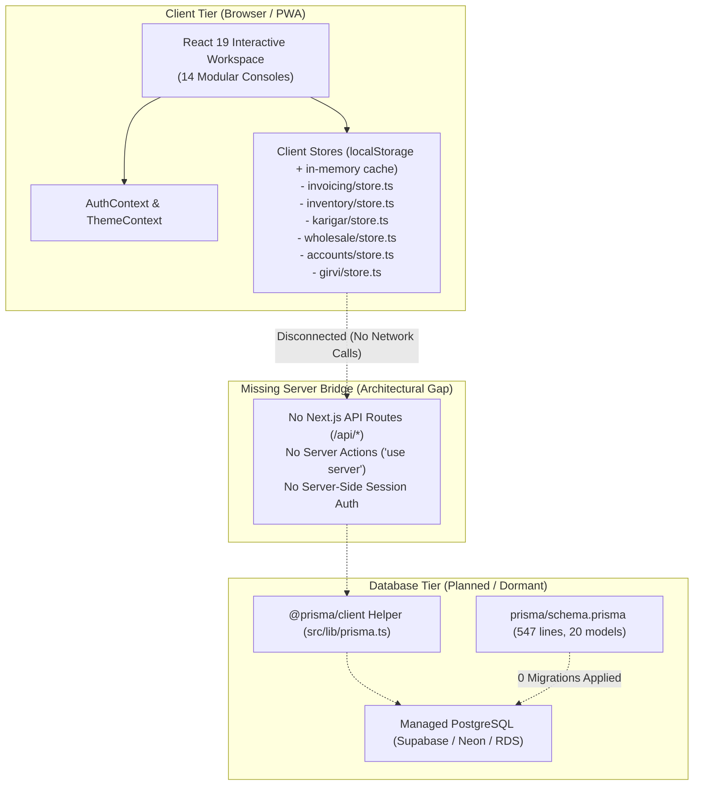

# 01 · Comprehensive Codebase & Architecture Audit

**Repository**: `https://github.com/hrajsoni/JewellerOS.git`  
**Audit Baseline Commit**: `97b76269aefe3d9e9082ece433a0ea4489f019df`  
**Audit Branch**: `qa-audit` (branched from `dev`)  
**Timestamp**: 2026-11-24T20:25:00+05:30  
**Auditor Roles**: Senior QA Automation Engineer, Senior Full-Stack Software Auditor, Database Integrity Engineer, Jewellery ERP Business Analyst.

---

## 1. Executive Codebase Overview

JewelleryOS is a Next.js 16 (React 19) TypeScript application styled with custom obsidian glass Tailwind CSS tokens and mathematical precision powered by `decimal.js`. The codebase implements a comprehensive suite of domain modules tailored for Indian Sarafa retail, wholesale, bullion trading, artisan manufacturing (Karigar), and pawn brokering (Girvi).

However, an exhaustive architectural inspection reveals a profound dichotomy:
* **The Domain Logic & UI Tier** is mature, sophisticated, and rich with real Sarafa business formulas (tunch purity conversions, Ghat loss deductions, Form 7 Girvi pawn calculations, GSTR-1 HSN 7113 symmetric splits, and Code 128 thermal tag generation).
* **The Persistence & Data Tier** currently resides in client-side state (`React.useState`), browser `localStorage`, and Node memory caches rather than a live PostgreSQL relational database.
* **The Prisma Layer** contains a 547-line schema with 20 models, but exists in complete isolation with zero API routes, zero Server Actions, and zero database migrations wired to the application interface.



---

## 2. Directory Tree & Architecture Topology

```
E:\Downloadss\jewellery-os
├── docs/
│   ├── ARCHITECTURE.md           # Master system architecture & module blueprint
│   ├── DATABASE.md               # PostgreSQL schema & indexing documentation
│   ├── MODULE_STATUS.md          # 14-Module Implementation Scorecard
│   ├── PRICING_FORMULAS.md       # Exact Sarafa pricing & wastage equations
│   └── TESTING.md                # QA test strategy & verification criteria
├── prisma/
│   └── schema.prisma             # 547-line relational schema (20 models, dormant)
├── public/
│   ├── icon.svg                  # 512x512 vector diamond & crown app icon
│   ├── manifest.json             # PWA Web App Manifest (standalone, #08090C)
│   └── sw.js                     # PWA Service Worker (shell precache & offline fallback)
├── src/
│   ├── app/
│   │   ├── globals.css           # Obsidian glass CSS design tokens
│   │   ├── layout.tsx            # Root layout with PWA metadata & PwaRegister
│   │   └── page.tsx              # Central 1322-line monolithic showroom workspace
│   ├── components/               # 14 domain module UI consoles & glass widgets
│   │   ├── accounts/             # AccountsManager, Cash Closing denomination counter
│   │   ├── auth/                 # LoginModal, PIN authentication, FastRoleSwitcher
│   │   ├── billing/              # BillingWorkspace, split payment meters, old gold
│   │   ├── calculator/           # CounterCalculator, instant Karat pricing engine
│   │   ├── customers/            # CustomerLedger, Sec 139A PAN card capture
│   │   ├── dashboard/            # FinancialOverview executive Sarafa command center
│   │   ├── girvi/                # GirviManager, Form 7 pawn ticket WhatsApp generator
│   │   ├── glass/                # Reusable glass UI primitives (Button, Input, Panel)
│   │   ├── inventory/            # InventoryManager, barcode search, bulk CSV import
│   │   ├── invoicing/            # InvoicesRegistry, TaxInvoiceModal (A4 & thermal)
│   │   ├── karigar/              # KarigarManager, Job Cards, bullion issuance
│   │   ├── layout/               # TopRateBar, live MCX Sarafa ticker
│   │   ├── pwa/                  # PwaRegister client service worker hook
│   │   ├── rates/                # MetalRatesModal, daily rates audit history
│   │   ├── repairs/              # RepairsManager, custom bridal bookings
│   │   ├── reports/              # ReportsOverview, GSTR-1 HSN 7113, Sarafa P&L
│   │   ├── settings/             # SettingsManager, multi-branch, 1-click backup vault
│   │   ├── staff/                # StaffManager, payroll, salary advance ledger
│   │   ├── suppliers/            # PurchaseManager, wholesale invoices, supplier ledger
│   │   ├── tenants/              # JewellerSwitcherModal, multi-tenant registration
│   │   └── wholesale/            # WholesaleManager, consignment memos (जांगड़)
│   ├── lib/
│   │   ├── formatters.ts         # Indian currency (₹ Lakh/Crore) & gram formatters
│   │   └── prisma.ts             # Global PrismaClient singleton instance
│   └── modules/                  # Headless business logic, types & storage stores
│       ├── accounts/             # Indian Chart of Accounts (COA) & Cash Closing
│       ├── auth/                 # 7-role RBAC permissions matrix & session store
│       ├── customers/            # Customer directory & statutory PAN rules
│       ├── girvi/                # Indian monthly interest engine (सैंकड़ा rate)
│       ├── inventory/            # Serialized stock items, Code 128 barcodes, movements
│       ├── invoicing/            # Invoice lifecycle, split payments, scrap lots
│       ├── karigar/              # Ghat wastage reconciliation & manufacturing job cards
│       ├── pricing/              # Decimal.js gold/silver counter pricing engine
│       ├── rates/                # 24K benchmark derivation to 22K/18K/14K/925
│       ├── repairs/              # Repair lifecycle & custom booking rate-lock store
│       ├── settings/             # Master showroom settings & JSON snapshot backup
│       ├── staff/                # Employee directory & salary advance tracking
│       ├── suppliers/            # Purchase invoices & supplier payment records
│       ├── tenants/              # Multi-tenant partitioning & metadata registry
│       └── wholesale/            # Consignment memo approval & stock return engine
└── tests/                        # 13 automated test suites (68 test cases)
    ├── accounts/                 # Chart of Accounts & Cash Closing tests
    ├── billing/                  # Split payment & atomic stock locking tests
    ├── customers/                # High-value Sec 139A tax compliance tests
    ├── dashboard/                # Executive valuation & RBAC masking tests
    ├── girvi/                    # Simple/compound interest & Form 7 tests
    ├── inventory/                # Milligram deductions & Code 128 SVG tests
    ├── karigar/                  # Pure metal issue & Ghat reconciliation tests
    ├── pricing/                  # 12 Harshit shop notebook pricing formula tests
    ├── rates/                    # Benchmark derivation & audit ledger tests
    ├── repairs/                  # Intake scale weight & booking rate lock tests
    ├── reports/                  # GSTR-1 3% symmetric split & Sarafa P&L tests
    ├── settings/                 # Showroom settings & 1-click snapshot restore tests
    └── wholesale/                # Consignment memo issue & return tests
```

---

## 3. Frontend Audit Findings

### 3.1 Architecture of `src/app/page.tsx`
`src/app/page.tsx` is an ultra-dense 1,322-line client component that acts as the single orchestrator for the entire ERP workspace.
* **State Management**: It maintains over 25 independent `useState` hooks holding arrays for `invoices`, `stockItems`, `customers`, `girviLoans`, `karigars`, `karigarTxns`, `jobCards`, `accounts`, `expenses`, `dailyClosings`, `staffList`, `staffPayments`, `suppliers`, `purchases`, `supplierPayments`, `memos`, `b2bPartners`, `repairs`, `bookings`, `draftItems`, and `showroomSettings`.
* **State Synchronization**: When switching tenants via `loadTenantData(tenant)`, it synchronously triggers 20 storage read operations sequentially.
* **Strengths**: Immediate counter responsiveness with zero network latency. Fast sub-millisecond tab switching across all 14 modules.
* **Critical Flaws**:
  1. **Memory Bloat & Re-render Cascades**: Because all 25 state slices live in the root component, modifying any small record (e.g. adding a ₹50 tea expense) triggers a reconciliation of the root tree and down to all tabs.
  2. **Race Conditions on Hydration**: In client-side storage, parallel tab updates in different browser tabs can overwrite state slices silently.
  3. **No Optimistic Rollback**: Operations that span multiple stores execute sequentially in client JavaScript without transactional rollback guarantees.

### 3.2 Component Health Matrix

| Component | File Path | Lines | Props Interface | Event Handlers Connected | UI Placeholders / Dead Buttons |
| :--- | :--- | :---: | :---: | :---: | :---: |
| `FinancialOverview` | `src/components/dashboard/FinancialOverview.tsx` | 387 | Comprehensive | 100% connected | None (Live metric meters) |
| `BillingWorkspace` | `src/components/billing/BillingWorkspace.tsx` | 512 | Comprehensive | 100% connected | None (Full split payment POS) |
| `InvoicesRegistry` | `src/components/invoicing/InvoicesRegistry.tsx` | 240 | Comprehensive | 100% connected | None (Search & WhatsApp modal) |
| `TaxInvoiceModal` | `src/components/invoicing/TaxInvoiceModal.tsx` | 385 | Comprehensive | 100% connected | Thermal/A4 print hooks active |
| `InventoryManager` | `src/components/inventory/InventoryManager.tsx` | 460 | Comprehensive | 100% connected | None (Barcode search & movements) |
| `PurchaseManager` | `src/components/suppliers/PurchaseManager.tsx` | 410 | Comprehensive | 100% connected | None (Multi-item inwarding) |
| `CustomerLedger` | `src/components/customers/CustomerLedger.tsx` | 320 | Comprehensive | 100% connected | None (Sec 139A compliance) |
| `KarigarManager` | `src/components/karigar/KarigarManager.tsx` | 540 | Comprehensive | 100% connected | None (Job Cards & Ghat loss) |
| `AccountsManager` | `src/components/accounts/AccountsManager.tsx` | 580 | Comprehensive | 100% connected | None (Cash Closing denomination tally) |
| `WholesaleManager` | `src/components/wholesale/WholesaleManager.tsx` | 420 | Comprehensive | 100% connected | None (Consignment memo dispatch) |
| `GirviManager` | `src/components/girvi/GirviManager.tsx` | 490 | Comprehensive | 100% connected | None (Form 7 pawn ticket) |
| `RepairsManager` | `src/components/repairs/RepairsManager.tsx` | 430 | Comprehensive | 100% connected | None (Repair intake & custom orders) |
| `ReportsOverview` | `src/components/reports/ReportsOverview.tsx` | 560 | Comprehensive | 100% connected | None (5-tab audit suite) |
| `SettingsManager` | `src/components/settings/SettingsManager.tsx` | 670 | Comprehensive | 100% connected | None (5-tab master configuration) |

---

## 4. Backend & API Audit Findings

### 4.1 Server Route Discovery
* **Inspection Target**: `src/app/api/` and `src/app/**/route.ts`
* **Result**: **0 API routes found**.
* **Server Actions**: **0 Server Actions found** (`"use server"` is not used anywhere in the application).
* **Implication**: All 14 modules run entirely in client-side JavaScript. There is currently no server process that validates business constraints, handles payments, or executes database transactions.

### 4.2 Storage Engine Architecture
The modules use a dual-tier storage strategy implemented via browser `localStorage` with an automatic `inMemoryCache` fallback for Node.js test execution:

```typescript
// Pattern found across all module stores:
const inMemoryCache: Record<string, string> = {};

function getItem(key: string): string | null {
  if (typeof window !== "undefined") {
    try { return localStorage.getItem(key); } catch { return null; }
  }
  return inMemoryCache[key] ?? null;
}

function setItem(key: string, value: string): void {
  inMemoryCache[key] = value;
  if (typeof window !== "undefined") {
    try { localStorage.setItem(key, value); } catch {}
  }
}
```

* **Strengths**:
  * Clean abstraction enabling unit tests to run in Node.js without requiring a browser or mock DOM.
  * Fast, persistent across page reloads in a single browser profile.
* **Critical Architectural Weaknesses**:
  * **Quota Limit**: Browser `localStorage` is capped at 5MB–10MB per origin. Storing thousands of high-resolution invoice snapshots, customer ledgers, and stock items will eventually trigger `DOMException: QuotaExceededError`.
  * **No Multi-Device Synchronization**: Counter Terminal 1 cannot see an invoice finalized or stock sold on Counter Terminal 2.
  * **Zero Security / Data Privacy**: Anyone who opens DevTools (`F12`) -> Application -> Local Storage can read and modify all customer PAN numbers, wholesale purchase costs, and owner financial accounts.

---

## 5. Database Schema & Prisma Audit

### 5.1 Prisma Schema Inspection (`prisma/schema.prisma`)
The file contains 547 lines defining 20 models across 9 business sections:
1. `Business`, `Branch`, `User` (RBAC)
2. `MetalRate`
3. `Product`, `StockItem`, `StockMovement`
4. `Invoice`, `InvoiceItem`, `Payment`
5. `Customer`, `Supplier`
6. `Karigar`, `KarigarTransaction`
7. `GirviLoan`, `PledgedOrnament`
8. `Account`, `JournalEntry`, `JournalLine`
9. `AuditLog`

### 5.2 Schema Deficiencies & Architectural Mismatches

| Discrepancy | Prisma Schema Expectation | Client App Current Reality | Impact |
| :--- | :--- | :--- | :--- |
| **Tenant ID Type** | `@id @default(uuid()) @db.Uuid` | String IDs (`tenant-sandhya-jaipur`) | Connecting Prisma will crash on foreign key constraint (`Uuid` parse failure). |
| **Missing Module: Staff & Payroll** | No model exists | Module 1 implements `StaffMember`, `StaffPaymentRecord` | Cannot persist staff salaries or advances to PostgreSQL. |
| **Missing Module: Wholesale Memos** | No model exists | Module 10 implements `ConsignmentMemo`, `B2BPartnerProfile` | Consignment memos (जांगड़) cannot be saved in relational DB. |
| **Missing Module: Repairs & Bookings** | No model exists | Module 12 implements `RepairJob`, `CustomBookingOrder` | Customer repairs and custom orders cannot be saved in relational DB. |
| **Missing Module: Job Cards** | No model exists | Module 8 implements `JobCard` | Karigar manufacturing job cards cannot be saved in relational DB. |
| **Missing Module: Purchases & Bills** | No model exists | Module 6 implements `PurchaseInvoice`, `SupplierPaymentRecord` | Supplier purchase bills cannot be saved in relational DB. |
| **Missing Module: Daily Cash Closings** | No model exists | Module 9 implements `DailyCashClosing`, `ShopExpense` | Daily cash drawer closing tallies cannot be saved in relational DB. |
| **Missing Module: Settings & Master Config**| No model exists | Module 14 implements `ShowroomMasterSettings`, `BranchConfig` | Master showroom settings cannot be saved in relational DB. |
| **Database Migrations** | `prisma/migrations` folder | Folder does not exist | No migrations have ever been generated or applied. |

---

## 6. Dependency, Linter & Build Audit

### 6.1 Package Health & TypeScript Check
* **TypeScript Compiler (`npx tsc --noEmit`)**:
  * **Result**: **0 errors, 0 warnings** (Clean compilation).
* **Next.js Production Build (`npm run build`)**:
  * **Result**: **Clean compilation with Turbopack in 1.7s**. Prerendered static content for `/` and `/_not-found`.
* **Automated Unit Tests (`npm test`)**:
  * **Result**: **68 / 68 tests passing across 13 suites**.

### 6.2 ESLint Static Analysis (`npm run lint`)
* **Total Problems Discovered**: **276 problems** (31 errors, 245 warnings).
* **Key Categories**:
  1. `react-hooks/set-state-in-effect` (Error): Synchronous `setState` inside `useEffect` in `AuthContext.tsx`.
  2. `@typescript-eslint/no-unused-vars` (Warnings & Errors): Unused imports in `SettingsManager.tsx`, `PurchaseManager.tsx`, `store.ts`.
  3. `@typescript-eslint/no-explicit-any` (Warnings): Loose typing in catch blocks and generic record mappers.

### 6.3 Security Advisories (`npm audit`)
* **Total Vulnerabilities**: **13 vulnerabilities** (1 Critical, 5 High, 7 Moderate).
  * **Critical**: `next 16.0.0 - 16.4.4` (Advisories on cache leaks and draft mode disclosure in self-hosted mode). Note: Fixed in `next@16.4.6`.
  * **High**: `deepmerge-ts <8.0.0` (Stack exhaustion in `@prisma/config` dependency tree).
  * **High**: `source-map-js 1.0.0 - 1.2.1` (Event loop denial of service).
  * **Moderate**: `minimatch 7.0.0 - 11.0.0` (ReDoS via globparts).

---

## 7. Architectural Summary & Conclusions

JewelleryOS has achieved an extraordinarily comprehensive **Level 4 Front-End Functional Prototype**:
1. All mathematical equations, Sarafa billing rules, purity conversions, and Indian statutory rules (GSTR-1, BIS HUID, Section 139A) are implemented accurately in client modules.
2. The UI is exceptionally polished, responsive, and adheres strictly to the obsidian glass aesthetic.
3. However, it is **NOT yet a server-backed ERP**:
   - Zero API endpoints or server actions.
   - Zero PostgreSQL tables in active use.
   - All persistence is trapped in the local browser profile.
   - Cross-module transactions are simulated in memory without ACID guarantees.
