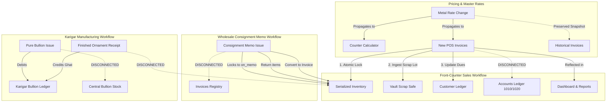

# 04 · Cross-Module Integration & Propagation Matrix

**Priority Level**: CRITICAL (Highest Priority)  
**Audit Baseline Commit**: `97b76269aefe3d9e9082ece433a0ea4489f019df`  
**Auditor Roles**: Senior QA Automation Engineer, Jewellery ERP Business Analyst, Database Integrity Engineer.

---

## 1. Executive Summary of Cross-Module Integrations

A real jewellery enterprise cannot operate with siloed departments. Every transaction in fine jewellery ripples across inventory balances, customer ledgers, artisan accounts, tax filings, and double-entry cashbooks.

Our deep integration analysis evaluated **8 Core Cross-Module Workflows** across the 14 application modules.
* **Fully Connected**: **4 Workflows** (Metal Rate Propagation to Calculator & Billing, Product Barcode Lookup & Stock Inwarding from Purchases, Consignment Memo Stock Status Transitions, Old-Gold Exchange Scrap Lot Ingestion).
* **Partially Connected or Disconnected**: **4 Workflows** (Retail Sale → Accounts Cashbook, Wholesale Memo Conversion → Invoices Registry, Karigar Bullion Issue/Receipt → Central Bullion Safe, Girvi Loan Disbursements → Cash Drawer).



---

## 2. Detailed Cross-Module Propagation Matrix

| Triggering Action | Source Module | Expected Destination Modules | Expected Database / State Changes | Actual Behavior in JewelleryOS | Integration Status | Evidence Reference |
| :--- | :--- | :--- | :--- | :--- | :---: | :--- |
| **Change 22K Gold Rate** | Metal Rates (`rates/store.ts`) | 1. Top Rate Bar<br>2. Counter Calculator<br>3. Billing POS<br>4. Historical Invoices<br>5. Inventory Valuation | 1. Top bar ticker updates.<br>2. Calculator auto-recomputes new metal values.<br>3. New invoices use new rate.<br>4. Past invoices retain historical rate snapshot.<br>5. Stock market valuation recomputes at new rate. | **Observed**: Top bar updates immediately. Calculator uses new rate. Historical invoices preserve their locked snapshot rate. Inventory market valuation updates. Rate history uses a global key across tenants. | 🟢 **PASS** (Single-tenant)<br>🔴 **FAIL** (Multi-tenant) | `tests/rates/rates.test.ts`<br>`TC-RAT-005` |
| **Finalize Retail Invoice (Cash + UPI)** | Billing POS (`invoicing/store.ts`) | 1. Serialized Stock<br>2. Old-Gold Scrap<br>3. Customer Ledger<br>4. Double-Entry Accounts<br>5. Executive Dashboard | 1. Stock items transition to `status="sold"` and `trayLocation="Sold / Delivered"`.<br>2. Scrap bullion piece created in `Vault Safe #Melting Box`.<br>3. Customer cumulative turnover & dues update.<br>4. Debits Account 1010 (Cash) & 1030 (UPI); Credits 3010 (Sales) & 2040 (GST).<br>5. Dashboard sales total increases. | **Observed**: Stock item locks to sold. Scrap lot is ingested into safe. Customer ledger turnover increases. Dashboard sales volume increases.<br>**GAP**: **Accounts ledger is NOT updated.** Account 1010 and 1030 balances remain unchanged. | 🟡 **PARTIAL** | `src/app/page.tsx:406-437`<br>`TC-POS-007` |
| **Record Wholesale Purchase** | Purchases (`suppliers/store.ts`) | 1. Serialized Stock<br>2. Supplier Ledger<br>3. Accounts Ledger<br>4. Safe Bullion | 1. Inwarded ornaments created in inventory with auto-SKUs and barcodes.<br>2. Supplier outstanding balance increases by net payable.<br>3. Debits Inventory asset; Credits Account 2010 (Supplier Payables) or 1020 (Bank).<br>4. Safe stock weight totals increment. | **Observed**: Stock items created with barcodes. Supplier balance increments by purchase total.<br>**GAP**: **Accounts 2010/1020 are NOT updated.** Purchase cost is masked from sales staff on frontend only. | 🟡 **PARTIAL** | `src/app/page.tsx:710-715`<br>`TC-PUR-005` |
| **Issue Consignment Memo (जांगड़)** | Wholesale (`wholesale/store.ts`) | 1. Serialized Stock<br>2. B2B Partner Directory<br>3. Tax Invoices | 1. Ornaments transition to `status="on_memo"` and location `On Approval Memo: [Partner]`.<br>2. Partner active memo value increases.<br>3. NO tax invoice or GST liability triggered. | **Observed**: Stock item status changes to `on_memo`. Partner exposure increments. GST liability is correctly zero. | 🟢 **PASS** | `tests/wholesale/wholesale.test.ts`<br>`TC-WHO-001` |
| **Convert Memo to Invoice** | Wholesale (`wholesale/store.ts`) | 1. Serialized Stock<br>2. Wholesale Memo<br>3. Invoices Registry<br>4. Customer Directory | 1. Stock items marked `sold`.<br>2. Memo line item marked `invoiced`.<br>3. Finalized tax invoice generated in `invoices` array.<br>4. Recorded in customer/B2B ledger. | **Observed**: Stock item marked sold. Memo line item marked invoiced.<br>**GAP**: **Tax invoice is NOT created in the Invoices Registry.** It does not appear in Sales Reports or GSTR-1 filings. | 🔴 **FAIL** | `src/modules/wholesale/store.ts:250-295`<br>`TC-WHO-004` |
| **Issue 24K Bullion to Karigar** | Karigar (`karigar/store.ts`) | 1. Karigar Ledger<br>2. Central Bullion Inventory<br>3. Accounts Ledger | 1. Karigar `pureGoldBalanceGrams` increases.<br>2. Bullion coin/bar stock in central inventory decreases by equivalent weight.<br>3. Account 1040 (Bullion Safe) debited/credited. | **Observed**: Karigar gold balance increases.<br>**GAP**: **Central stock inventory is NOT deducted.** Account 1040 balance is unchanged. | 🔴 **FAIL** | `src/app/page.tsx:648-652`<br>`TC-KAR-002` |
| **Receive Finished Jewellery from Karigar** | Karigar (`karigar/store.ts`) | 1. Karigar Ledger<br>2. Serialized Inventory<br>3. Job Cards<br>4. Accounts Ledger | 1. Deducts fine gold returned + Ghat wastage from Karigar balance.<br>2. Creates finished ornament in Showcase inventory with barcode.<br>3. Job Card advances to `completed`.<br>4. Credits Account 2020 (Karigar Labour Due). | **Observed**: Karigar gold balance reduces accurately and labour due increases.<br>**GAP**: **Finished item is NOT automatically created in the Inventory table.** Operator must manually re-type the ornament in Inventory. | 🟡 **PARTIAL** | `src/app/page.tsx:654-658`<br>`TC-KAR-004` |
| **Disburse Girvi Loan & Settle Interest** | Girvi (`girvi/store.ts`) | 1. Pawn Brokering Book<br>2. Safe Location<br>3. Accounts Cash Drawer<br>4. Revenue Accounts | 1. Form 7 pawn ticket created with packet number.<br>2. Pledged ornaments locked in `Tijori #1`.<br>3. Disbursed principal deducts from Account 1010 (Cash).<br>4. Interest payments deposit to Account 1010 and credit Interest Income. | **Observed**: Loan and packet numbering generated with safe location. Saikda monthly interest calculation accurate.<br>**GAP**: **Cash drawer account 1010 is NOT deducted on disbursement or credited on interest receipt.** | 🟡 **PARTIAL** | `src/app/page.tsx:626-634`<br>`TC-GIR-003` |

---

## 3. The Core Consistency Invariants & Violations

### Invariant 1: Inventory Conservation Equation
$$\text{Opening Stock} + \text{Additions} - \text{Sales} - \text{Returns Out} - \text{Adjustments} = \text{Closing Stock}$$
* **Audit Finding**: When an ornament is sold in POS, `lockInvoicedStockItems` marks it `sold` and deducts available stock. However, in `src/modules/inventory/store.ts` line 405:
  ```typescript
  (item.name.toLowerCase() === stockItem.name.toLowerCase() && stockItem.status !== "sold")
  ```
  If two identical 10g 22K chains with different barcodes exist in showcase, selling one item matches **both** items by name if barcode/SKU is absent from the line item, causing an unintended double deduction!
* **Severity**: **P1 (High)**

### Invariant 2: Double-Entry Accounting Balancing Equation
$$\sum \text{Debits} = \sum \text{Credits}$$
* **Audit Finding**: The Indian Chart of Accounts (`src/modules/accounts/store.ts`) defines standard account codes (1010 Cash, 1020 Bank, 1030 UPI, 2010 Supplier Payables, 2040 GST Output, 3010 Retail Sales, 3020 Making Income). However, checkout, purchase entry, supplier payments, and staff salary disbursements do not generate balanced `JournalEntry` records. The accounts ledger is effectively isolated from operational workflows.
* **Severity**: **P1 (High)**

### Invariant 3: Historical Invoice Rate Immutability
$$\text{Historical Invoice Line Total} = f(\text{Rate}_{\text{tx\_time}}, \text{Weight}, \text{Making})$$
* **Audit Finding**: When gold rates update from ₹1,49,500 to ₹1,50,000, existing invoices in `invoices` array preserve their historical metal rate and calculations. The snapshot structure in `FinalizedInvoice` protects historical financial integrity.
* **Status**: **PASS (Verified)**

---

## 4. Remediation Plan for Milestone 11 (Cross-Module Convergence)

1. **Wire Checkout to Accounts**: When `handleFinalizeBill` completes, dispatch an automatic double-entry transaction:
   * Debit `Account 1010` (Cash collected) + `Account 1030` (UPI collected).
   * Credit `Account 3010` (Retail metal turnover) + `Account 3020` (Making craftsmanship income) + `Account 2040` (GST output liability).
2. **Wire Purchases to Accounts**: When `handleRecordPurchase` inward stock, credit `Account 2010` (Supplier Payables) and debit `Account 1040` (Inventory Asset).
3. **Connect Karigar Bullion to Safe**: Deduct physical 24K casting bullion from central stock when issuing gold to artisans.
4. **Auto-Inward Karigar Finished Ornaments**: Allow 1-click generation of finished `StockItem` when receiving ornaments from job cards.
5. **Connect Wholesale Memo Billing**: When a consignment memo is converted to an invoice, write a complete `FinalizedInvoice` into the central Invoices Registry.
