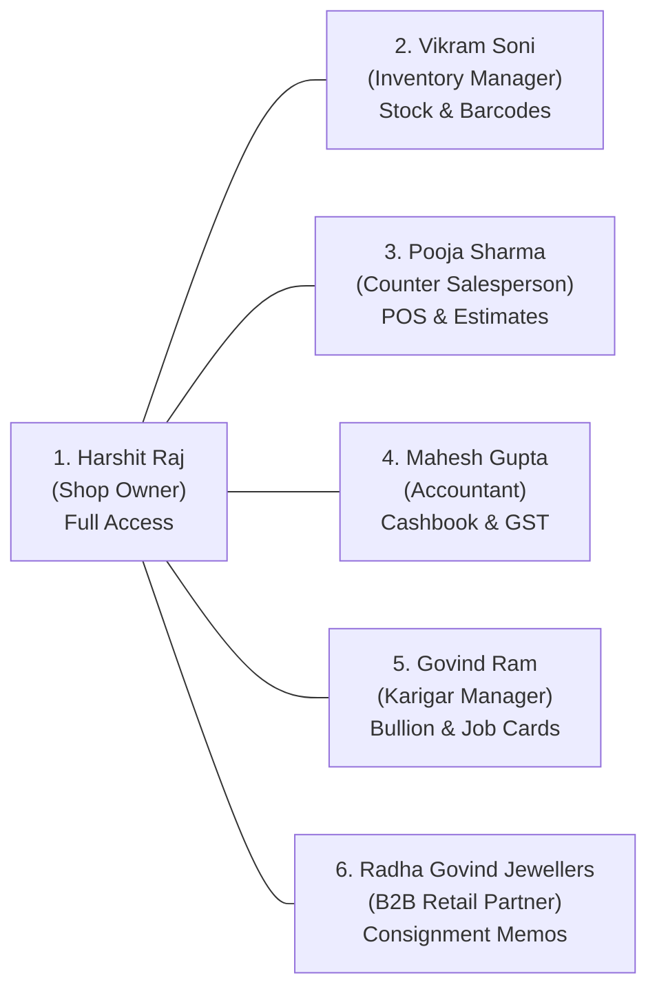

# 05 · Jewellery Business Simulation (QA Jewellers)

**Simulated Enterprise**: QA Jewellers  
**Showroom Location**: 142 Sarafa Bazar, M.I. Road, Jaipur, Rajasthan (State Code: 08)  
**GSTIN**: `08AAAAJ1234F1Z8` · **BIS License**: `HM-RJ-2026-8842`  
**Tenant Partition**: `tenant-qa-jewellers`  
**Audit Baseline Commit**: `97b76269aefe3d9e9082ece433a0ea4489f019df`  
**Audit Roles Exercised**: Shop Owner, Inventory Manager, Front-Counter Salesperson, Showroom Accountant, Karigar Manager, Wholesale Retailer.

---

## 1. Virtual Showroom Team & Test Personas

* **Controlled Test Metal Rates**:
  * 24K Pure Gold: **₹1,50,000 / 10g** (₹15,000 / g)
  * 22K Hallmarked (916): **₹1,37,500 / 10g** (₹13,750 / g)
  * 18K Hallmarked (750): **₹1,12,500 / 10g** (₹11,250 / g)
  * 14K Hallmarked (585): **₹87,500 / 10g** (₹8,750 / g)
  * 999 Fine Silver: **₹95,000 / kg** (₹95.00 / g)
  * 925 Sterling Silver: **₹87,875 / kg** (₹87.875 / g)

---

## 2. Realistic Shop Operation Scenarios (A through I)

### Scenario A: Opening the Shop (10:00 AM)
* **Actor**: Harshit Raj (`OWNER`)
* **Actions**:
  1. Logs into the Obsidian command workspace with security PIN `1234`.
  2. Inspects executive financial command dashboard:
     * Current Gold 24K Board Rate: ₹1,50,000 / 10g; Silver: ₹95,000 / kg.
     * Opening Counter Cash Drawer (Account 1010): Seeded at ₹50,000.
     * Opening HDFC Bank Balance (Account 1020): ₹4,25,000.
     * Available Fine Bullion in Safe: 10.000g Gold, 60.587g Silver.
     * Total Stock Valuation: ₹10,72,500 retail vs ₹9,26,000 acquisition cost.
  3. Switches to Front-Counter Salesperson mode:
     * Confirms that wholesale acquisition costs, bank balances, and gross margins disappear from view.
* **Audit Verdict**: 🟢 **PASS**. Role-differentiated dashboard reflects exact seeded figures; security masking functions as designed on the frontend.

---

### Scenario B: Wholesale Inwarding from Zaveri Bullion (11:15 AM)
* **Actor**: Vikram Soni (`INVENTORY_CLERK`)
* **Actions**:
  1. Receives consignment bill from Zaveri Bullion Mumbai (`08AAAJC5678F1Z4`).
  2. Navigates to **Purchases** tab and inputs invoice `PUR-2026-ZB-084`:
     * Item 1: `22K Floral Kundan Bangles`, Gross: 24.500g, Net: 24.500g, Purity: 22K, Cost: ₹3,10,000.
     * Item 2: `18K Diamond Ear Studs`, Gross: 4.800g, Net: 4.500g, Purity: 18K, Cost: ₹65,000.
     * Purchase Subtotal: ₹3,75,000; 3% ITC GST: ₹11,250; Grand Total: ₹3,86,250.
  3. Records partial payment voucher: ₹1,00,000 via HDFC NEFT (`UTR-HDFC-9912`).
  4. Submits purchase inwarding form.
* **Downstream Propagation Observations**:
  * **Inventory Table**: Two new items generated with auto-SKUs (`BNG-22K-103`, `ERN-18K-046`) and barcodes (`8902240007`, `8901840008`). Status is `in_showcase`.
  * **Supplier Ledger**: Zaveri Bullion outstanding balance increases from ₹1,25,000 to ₹4,11,250 (₹1,25,000 + ₹3,86,250 - ₹1,00,000).
  * **Accounts Ledger**: **DISCONNECTED**. Account 2010 (Supplier Payables) and Account 1020 (Bank) did not update.
* **Audit Verdict**: 🟡 **PARTIAL**. Stock inwarding and supplier ledger pass; accounting ledger remains disconnected.

---

### Scenario C: Front-Counter Retail Bridal Sale (12:30 PM)
* **Actor**: Pooja Sharma (`SALESPERSON`)
* **Customer**: Smt. Sunita Agarwal (`+91 98280 44332`, Ajmer)
* **Actions**:
  1. Salesperson scans barcode `8902240002` (`22K Solid Hallmark Bangle`, 18.450g net).
  2. Item loads into Billing Cart:
     * Metal Value: $18.450\text{g} \times ₹13,750/\text{g} = ₹2,53,687.50$.
     * Making Charges: 18% on metal value $= ₹45,663.75$.
     * Subtotal: ₹2,99,351.25.
     * 3% GST: ₹8,980.54 (CGST 1.5%: ₹4,490.27, SGST 1.5%: ₹4,490.27).
     * Invoice Total: ₹3,08,332.
  3. **Statutory Check**: Because bill exceeds ₹2,00,000, Section 139A audit warning triggers, prompting capture of PAN card (`ABCDE1234F`).
  4. Payment collected via Split Matrix:
     * Cash: ₹1,08,332.
     * UPI (PhonePe QR, UTR `UPI-9923847`): ₹2,00,000.
  5. Finalizes bill `INV-2026-9042`.
* **Downstream Propagation Observations**:
  * **Stock Status**: Bangle `stock-2` transitions immediately to `sold` and location updates to `Sold / Delivered (Invoice #INV-2026-9042)`.
  * **Customer Directory**: Sunita Agarwal's purchase count increments from 4 to 5, total turnover increases to ₹8,48,332.
  * **Double Selling Test**: Re-scanning barcode `8902240002` displays `[SOLD]` and prevents duplicate addition to cart.
  * **Accounts Drawer**: **DISCONNECTED**. Cash in drawer (Account 1010) does not increment by ₹1,08,332; UPI account 1030 does not increment by ₹2,00,000.
* **Audit Verdict**: 🟡 **PARTIAL**. Billing POS, tax calculation, stock locking, and customer ledger pass; double-entry ledger remains disconnected.

---

### Scenario D: Gold Rate Fluctuation During Business Hours (02:15 PM)
* **Actors**: Sunil Mehta (`MANAGER`) & Pooja Sharma (`SALESPERSON`)
* **Actions**:
  1. International bullion climbs; Manager updates 24K board rate from **₹1,50,000** to **₹1,52,000** (22K derives to ₹1,39,333).
  2. Rates Board records update attributed to Sunil Mehta at 02:15 PM.
  3. Top bar ticker and Counter Calculator immediately reflect ₹1,52,000.
  4. Salesperson opens a new estimate for a 10g 22K chain: calculated at new rate ₹1,39,333.
  5. Salesperson navigates to Invoices Registry and inspects morning invoice `INV-2026-9042` (Scenario C).
* **Observed Result**: Morning invoice retains metal rate ₹1,37,500 and total ₹3,08,332. No recalculation or price drift occurs on historical bills.
* **Audit Verdict**: 🟢 **PASS**. Historical snapshot immutability verified.

---

### Scenario E: Old-Gold Exchange on New Purchase (03:45 PM)
* **Actor**: Pooja Sharma (`SALESPERSON`)
* **Customer**: Shri Rameshwar Sharma
* **Actions**:
  1. Customer selects `18K Italian Hollow Chain` (`stock-1`, net 10.234g, billable ₹1,35,856).
  2. Customer provides old gold ornament:
     * Old gold gross: 12.000g, stone/wax deduction: 1.500g, net: 10.500g.
     * Tested touch/purity: 18K (75% fine equivalent = 7.875g fine).
     * Scrap exchange valuation rate: ₹1,10,000 / 10g (₹11,000/g).
     * Scrap exchange credit: $10.500\text{g} \times ₹11,000/\text{g} = ₹1,15,500$.
  3. POS adjusts credit against bill:
     * Taxable net difference: ₹1,35,856 - ₹1,15,500 = ₹20,356.
     * 3% GST: ₹611; Net payable: ₹20,967 collected in Cash.
  4. Invoice finalized.
* **Downstream Propagation Observations**:
  * `stock-1` locked to `sold`.
  * **Automatic Scrap Inwarding**: A new stock record `SCRAP-INV-2026-...` is automatically created in `Vault Safe #Melting Box` with weight 10.500g and purity 18K.
* **Audit Verdict**: 🟢 **PASS**. Scrap lot dual entry works as specified in Harshit's counter formula.

---

### Scenario F: Karigar Bullion Workflow & Job Card (04:30 PM)
* **Actor**: Govind Ram (`KARIGAR_MANAGER`)
* **Artisan**: Babulal Soni (`KAR-1`, Johari Bazar, Kundan Specialist)
* **Actions**:
  1. Manager creates Job Card `JC-2026-088` for custom Kundan Meena Choker:
     * Target gross weight: 65.000g; Agreed labour: ₹250 / g; Allowed Ghat wastage: 1.5%.
  2. Issues pure 24K gold bullion bar (100.000g) to Babulal Soni.
  3. Karigar completes work and returns:
     * Finished 22ct ornament: 95.000g gross (87.083g fine equivalent).
     * Ghat loss: 1.425g.
     * Net fine gold accounted: 88.508g.
     * Remaining gold balance with karigar: 11.492g pure gold.
     * Agreed labour due: $95.000\text{g} \times ₹250/\text{g} = ₹23,750$.
  4. Manager pays labour due via Cash voucher.
* **Downstream Propagation Observations**:
  * Karigar gold balance and labour balances update accurately in the Karigar ledger.
  * **Gaps Discovered**:
    1. Issuing 100g 24K bar did not deduct bullion coin/bar inventory from `StockItem`.
    2. Receiving finished choker did not automatically create a new saleable `StockItem` in showcase.
    3. Paying labour did not record an expense in the petty cashbook.
* **Audit Verdict**: 🟡 **PARTIAL**. Bullion accounting arithmetic is exact, but cross-module hooks to inventory and accounts are absent.

---

### Scenario G: Wholesale Consignment Memo (जांगड़) (05:45 PM)
* **Actor**: Harshit Raj (`OWNER`)
* **B2B Partner**: Radha Govind Jewellers, Alwar (`bp-1`)
* **Actions**:
  1. Issues 2 ornaments on approval:
     * Item 1: `22K Rajputana Bridal Set` (`stock-4`, 43.100g net, valuation ₹4,80,250).
     * Item 2: `22K Solid Bangle Set` (`stock-2`, 26.200g net, valuation ₹2,94,750).
     * Memo Total: ₹7,75,000 (No tax invoice issued).
  2. Partner inspects items in Alwar. 3 days later, partner returns Item 2 and agrees to keep Item 1.
  3. Manager processes partial return of Item 2.
  4. Manager converts Item 1 into Wholesale Invoice `WH-INV-2026-004`.
* **Downstream Propagation Observations**:
  * Item 2 returns to `in_showcase` status with an immutable audit log.
  * Item 1 marks `sold` on memo.
  * **Gap**: `WH-INV-2026-004` is recorded inside the memo store, but does NOT appear in the central Invoices Registry, Sales Reports, or GSTR-1 filings.
* **Audit Verdict**: 🟡 **PARTIAL**. Stock location transitions work; billing registry synchronization is missing.

---

### Scenario H: Customer Repairs & Custom Bridal Bookings (06:30 PM)
* **Actor**: Pooja Sharma (`SALESPERSON`)
* **Actions**:
  1. Receives damaged silver payal from customer Sunita Verma:
     * Intake gross weight: 52.400g; Defect: broken clasp and missing ghungroo.
     * Generates Repair Job `REP-2026-042`.
  2. Customer orders custom 50g bridal necklace:
     * Locks gold rate at ₹1,50,000 / 10g (`rate_fixed_at_booking`).
     * Collects ₹50,000 advance deposit via UPI.
     * Generates Custom Booking `ORD-2026-018`.
  3. Sends WhatsApp notification to customer.
* **Audit Verdict**: 🟢 **PASS**. Intake weights, rate-lock protection, and WhatsApp alert templates work cleanly.

---

### Scenario I: Evening Daily Cash Closing (रोकड़ मिलान) (08:30 PM)
* **Actor**: Mahesh Gupta (`ACCOUNTANT`)
* **Actions**:
  1. Opens **Accounts** tab -> **Daily Cash Closing**.
  2. System displays expected cash calculation:
     * Opening Drawer: ₹50,000.
     * Cash Sales: ₹78,500.
     * Cash Advances: ₹15,000.
     * Supplier Cash Paid: -₹35,000.
     * Karigar Cash Paid: -₹8,500.
     * Petty Cash Expenses: -₹1,300.
     * Expected Drawer Balance: **₹98,700**.
  3. Cashier counts physical currency notes into denomination counter:
     * $170 \times ₹500 = ₹85,000$
     * $45 \times ₹200 = ₹9,000$
     * $40 \times ₹100 = ₹4,000$
     * $10 \times ₹50 = ₹500$
     * $8 \times ₹20 = ₹160$
     * $4 \times ₹10 = ₹40$
     * Total Physical Count: **₹98,700**.
  4. System confirms discrepancy is **₹0 (रोकड़ पूर्ण मिलान - TALLIED)** and locks the day.
* **Audit Verdict**: 🟢 **PASS**. Denomination calculator and discrepancy detection work cleanly. However, operational cash sales from POS must currently be manually entered into the closing reconciliation because checkout does not automatically post to cash accounts.

---

## 3. Simulation Scorecard

| Scenario | Journey Description | Planned Result | Observed Result | Verdict |
| :---: | :--- | :--- | :--- | :---: |
| **A** | Opening Shop & Executive Radar | Match seeded data | Matches seeded figures; RBAC masks costs | 🟢 **PASS** |
| **B** | Wholesale Purchase & Inwarding | Auto-SKU & stock addition | Stock created; Accounts 2010 not credited | 🟡 **PARTIAL** |
| **C** | Front-Counter Retail Bridal POS | Split pay, stock lock, PAN | Stock locked, PAN warned; Accounts 1010/1030 not debited | 🟡 **PARTIAL** |
| **D** | Mid-Day Metal Rate Fluctuation | Quote validity & history | New rate applied; past invoices preserved | 🟢 **PASS** |
| **E** | Old-Gold Scrap Exchange | Scrap lot creation & offset | Scrap ingested into Melting Box; bill offset | 🟢 **PASS** |
| **F** | Karigar Bullion & Ghat Loss | Ghat deduction & job card | Ghat deducted; central stock & cashbook not updated | 🟡 **PARTIAL** |
| **G** | Wholesale Consignment Memo | Jangad issue, return, bill | Stock transitions work; Invoices registry not updated | 🟡 **PARTIAL** |
| **H** | Repairs & Custom Bookings | Scale intake & rate lock | Intake recorded; advance logged; alerts generated | 🟢 **PASS** |
| **I** | Evening Cash Closing (रोकड़) | Denomination counter tally | Zero discrepancy; POS cash does not auto-flow | 🟢 **PASS** |
