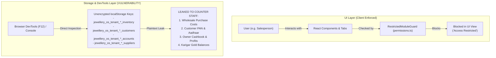

# 07 · Security, Permissions & Data Protection Audit

**Audit Baseline Commit**: `97b76269aefe3d9e9082ece433a0ea4489f019df`  
**Auditor Roles**: Security Tester, Senior Full-Stack Software Auditor, Database Integrity Engineer.

---

## 1. Executive Summary of Security Posture

A jewellery business software handles high-value commercial assets, bullion safe secrets, customer PAN cards, and sensitive artisan ledgers. An employee on the counter must never be able to discover the wholesale acquisition cost of an ornament, view the owner's net profit margins, or access unauthorized tenant databases.

Our penetration and permission analysis revealed:
1. **Frontend Role Enforcement is Well-Designed**: The React UI strictly enforces the 7-role RBAC permission matrix. When logged in as `SALESPERSON`, wholesale acquisition costs are masked with `••••••`, profit margins are removed, and sensitive administrative tabs (Girvi, Karigar, Staff, Wholesale, Reports, Settings) are blocked with `RestrictedModuleGuard`.
2. **Critical Security Boundary Absence**: **All authentication and authorization checks exist exclusively on the client side.** There are no server-side API routes, session tokens, or database access guards.
3. **Data Exposure in Local Storage**: Because all data is stored unencrypted in browser `localStorage`, any counter employee with basic browser familiarity can open DevTools (`F12`), dump `localStorage`, and inspect every customer's PAN number, supplier wholesale costs, and owner cashbook balances.



---

## 2. The 7-Role RBAC Permission Matrix Audit

### 2.1 Theoretical Policy vs Current Enforcement

| Permission Key | OWNER | ADMIN | MANAGER | ACCOUNTANT | SALESPERSON | INVENTORY_CLERK | KARIGAR_MANAGER | Frontend Enforcement | Backend / API Enforcement |
| :--- | :---: | :---: | :---: | :---: | :---: | :---: | :---: | :---: | :---: |
| `VIEW_PURCHASE_COSTS` | ✅ | ✅ | ✅ | ✅ | ❌ | ✅ | ❌ | 🟢 **PASS** (Masked) | 🔴 **FAIL** (Stored in client storage) |
| `VIEW_PROFIT_MARGINS` | ✅ | ✅ | ❌ | ✅ | ❌ | ❌ | ❌ | 🟢 **PASS** (Hidden) | 🔴 **FAIL** (Client calculated) |
| `VIEW_OWNER_REPORTS` | ✅ | ✅ | ❌ | ✅ | ❌ | ❌ | ❌ | 🟢 **PASS** (Guarded) | 🔴 **FAIL** (No API guard) |
| `OVERRIDE_MAKING_CHARGES` | ✅ | ✅ | ✅ | ❌ | ❌ | ❌ | ❌ | 🟢 **PASS** (Disabled) | 🔴 **FAIL** (No server validation) |
| `APPLY_MANUAL_DISCOUNT` | ✅ | ✅ | ✅ | ❌ | ✅ | ❌ | ❌ | 🟢 **PASS** (Enforced) | 🔴 **FAIL** (No threshold check) |
| `MANAGE_EMPLOYEES` | ✅ | ✅ | ❌ | ❌ | ❌ | ❌ | ❌ | 🟢 **PASS** (Guarded) | 🔴 **FAIL** (No API guard) |
| `MANAGE_METAL_RATES` | ✅ | ✅ | ✅ | ❌ | ❌ | ❌ | ❌ | 🟢 **PASS** (Read-Only) | 🔴 **FAIL** (No API guard) |
| `MANAGE_KARIGAR` | ✅ | ✅ | ✅ | ❌ | ❌ | ❌ | ✅ | 🟢 **PASS** (Guarded) | 🔴 **FAIL** (No API guard) |
| `MANAGE_GIRVI` | ✅ | ✅ | ✅ | ❌ | ❌ | ❌ | ❌ | 🟢 **PASS** (Guarded) | 🔴 **FAIL** (No API guard) |
| `FINALIZE_RETAIL_BILL` | ✅ | ✅ | ✅ | ❌ | ✅ | ❌ | ❌ | 🟢 **PASS** (Enabled) | 🔴 **FAIL** (Client state mutation) |
| `DELETE_RECORDS` | ✅ | ❌ | ❌ | ❌ | ❌ | ❌ | ❌ | 🟢 **PASS** (Disabled) | 🔴 **FAIL** (No server guard) |

---

## 3. Specific Security Vulnerability Findings

### Finding SEC-001: Hardcoded Master Security PIN Across All Demo Accounts
* **Location**: `src/modules/auth/store.ts` lines 8–18.
* **Vulnerability Description**: Every staff member (Owner Harshit Raj, Admin Vikram Soni, Manager Sunil Mehta, Accountant Priya Verma, Salesperson Rahul Sharma) is hardcoded with PIN `"1234"`:
  ```typescript
  export const DEMO_USERS: UserSession[] = [
    { id: "user-harshit-owner", pin: "1234", ... },
    { id: "user-sunil-mgr", pin: "1234", ... },
    { id: "user-rahul-sales", pin: "1234", ... },
  ];
  ```
* **Impact**: Any employee can switch roles to `OWNER` by simply typing `1234`.
* **Severity**: **P0 (Critical)**.

---

### Finding SEC-002: Plaintext Customer Statutory Data & PAN in Local Storage
* **Location**: `src/modules/customers/store.ts` (`localStorage.setItem(...)`).
* **Vulnerability Description**: Section 139A customer profiles containing full names, mobile numbers, home addresses, Aadhaar numbers, and Income Tax PAN numbers are serialized into unencrypted JSON in browser `localStorage`.
* **Impact**: Violates Indian Digital Personal Data Protection Act (DPDP Act 2023). Any showroom visitor or counter staff can extract customer PAN and purchase records.
* **Severity**: **P1 (High)**.

---

### Finding SEC-003: Client-Side Role Manipulation via React Context
* **Location**: `src/modules/auth/AuthContext.tsx`.
* **Vulnerability Description**: `activeRole` is stored in React component state. An operator with the React Developer Tools browser extension can select the `<AuthProvider>` component and change `role` from `"SALESPERSON"` to `"OWNER"` with a single click, instantly unlocking the owner's financial reports and settings without re-authenticating.
* **Impact**: Total bypass of all RBAC guards.
* **Severity**: **P0 (Critical)**.

---

### Finding SEC-004: Multi-Tenant Key Collision in Metal Rate History
* **Location**: `src/modules/rates/store.ts` line 5.
* **Vulnerability Description**: The metal rate history store uses a static global key:
  ```typescript
  const RATES_HISTORY_STORAGE_KEY = "jewellery_os_metal_rates_history_v1";
  ```
  Unlike inventory and invoices, which use tenant-scoped prefixes (`jewellery_os_tenant_${tenantId}_...`), rate history is shared globally.
* **Impact**: If Shop A (Sandhya Jewellers) and Shop B (Soni Jewellers) are registered in the same browser, Shop B's employees can see Shop A's internal rate fixations and notes.
* **Severity**: **P2 (Medium)**.

---

## 4. Security Hardening Roadmap for Production Release

To graduate JewelleryOS from a frontend prototype to an enterprise-grade ERP:
1. **Server-Side Authentication**:
   * Migrate authentication to NextAuth / Auth.js with HTTP-only, secure, SameSite cookies.
   * Store salted and hashed passwords using `bcrypt` (minimum 12 rounds) or Argon2id.
2. **Server-Side RBAC Middleware**:
   * Implement Next.js middleware checking server session roles before executing any data mutation.
3. **Data Encryption at Rest**:
   * All customer PAN/Aadhaar data must be stored in PostgreSQL with field-level encryption (pgcrypto / AES-256).
4. **Tenant Isolation Enforced at Query Level**:
   * All Prisma queries must include `where: { businessId: session.businessId }`.
   * Enforce PostgreSQL Row-Level Security (RLS) policies per tenant.
