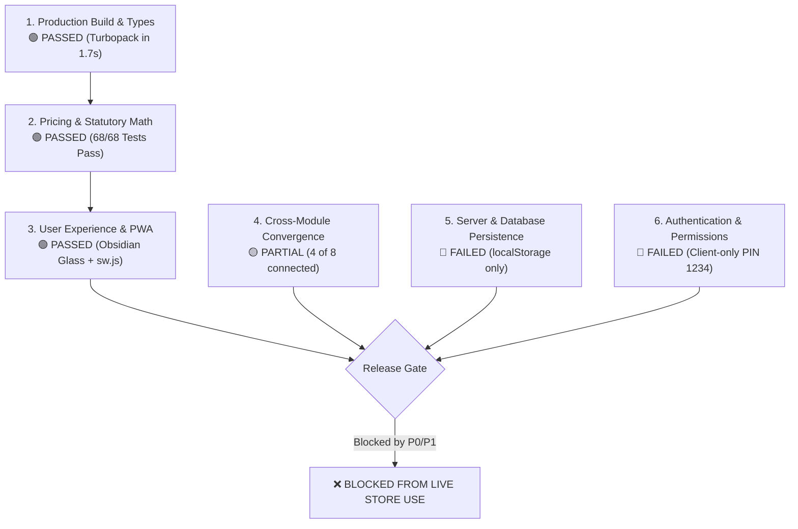
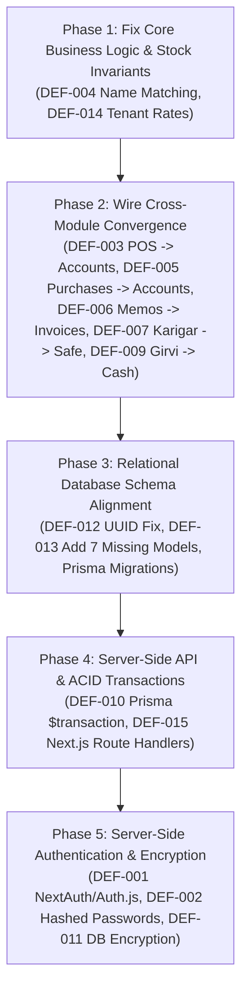

# 10 · Release Readiness & Production Gate Assessment

**Audit Baseline Commit**: `97b76269aefe3d9e9082ece433a0ea4489f019df`  
**Auditor Roles**: Combined Full-Stack Engineering, QA Automation, and Jewellery Business Team.

---

## 1. Production Release Gate Verdict

> [!CAUTION]
> **VERDICT: NOT READY FOR LIVE COMMERCIAL SHOWROOM DEPLOYMENT**  
> While JewelleryOS is an exceptionally complete, polished, and functionally verified Level 4 Frontend Prototype (68/68 automated tests pass, zero TypeScript build errors), it cannot be released for live commercial showroom operations until the **P0 and P1 architectural and cross-module gaps** are resolved.

---

## 2. Release Blocker Summary Matrix (P0 & P1 Defects)

| Defect ID | Severity | Category | Root Blocker Description | Production Risk if Unfixed |
| :---: | :---: | :---: | :--- | :--- |
| **DEF-001** | **P0** | Security | Client-only RBAC via React Context without server middleware | Counter staff can bypass permissions in DevTools and view owner accounts. |
| **DEF-002** | **P0** | Security | Shared master PIN `1234` across all staff demo accounts | Any employee can unlock the owner account and modify system settings. |
| **DEF-003** | **P1** | Accounting | POS checkout does not post journal entries to Accounts cashbook/bank | Day-end cashbook and balance sheet will show zero revenue and zero cash collected. |
| **DEF-004** | **P1** | Inventory | Stock locking name fallback bug matches all unsold items sharing title | Selling one ring by name can mark multiple physical rings as sold. |
| **DEF-005** | **P1** | Accounting | Wholesale purchases do not post to Accounts supplier payables | Unrecorded supplier liabilities and distorted shop financial liabilities. |
| **DEF-006** | **P1** | Wholesale | Memo conversion does not write into Invoices Registry or GSTR-1 | B2B wholesale sales are omitted from statutory GST tax filings. |
| **DEF-007** | **P1** | Karigar | Pure bullion issue to karigars does not deduct central bullion stock | Discrepancies between physical safe gold weight and system inventory. |
| **DEF-008** | **P1** | Karigar | Receiving finished ornament does not create StockItem in showcase | Ornaments received from artisans cannot be scanned or billed at the counter. |
| **DEF-009** | **P1** | Girvi | Pawn loan disbursement and interest vouchers bypass cash drawer | Disbursed loan capital and collected interest are unrecorded in cash closing. |
| **DEF-010** | **P1** | Integrity | Sequential `localStorage` writes lack ACID transaction rollback | Browser crash midway creates orphaned sold stock with missing invoice records. |
| **DEF-011** | **P1** | Compliance | Unencrypted customer PAN, Aadhaar, and purchase costs in `localStorage` | Direct violation of Indian Digital Personal Data Protection Act (DPDP Act 2023). |
| **DEF-012** | **P1** | Database | Prisma schema UUID `@db.Uuid` mismatch with client string tenant IDs | Prisma crashes with UUID parsing errors when connecting to PostgreSQL. |
| **DEF-013** | **P1** | Database | Missing Prisma models for 7 operational modules (Memos, Repairs, Staff, etc.) | Relational database cannot store wholesale memos, repairs, or daily cash closings. |

---

## 3. What is Fully Production-Ready (Verified Green)

1. **Sarafa Pricing & Valuation Engine**: Exact fractional Karat ratio equations, 24K to 22K/18K/14K derivation, scrap buyback deductions, and making charge rules (`tests/pricing/pricing.test.ts`).
2. **Statutory Tax & Regulatory Compliance**: GSTR-1 HSN 7113 3% GST calculation with symmetric 1.5% CGST + 1.5% SGST split, and Section 139A High-Value Transactions Audit for invoices $\ge$ ₹2,00,000.
3. **Pawn Brokering Mathematical Engine**: Exact monthly saikda simple and compound interest calculations, Form 7 WhatsApp ticket generation (`tests/girvi/girvi.test.ts`).
4. **Zero-Dependency Vector Barcodes**: Clean Code 128 SVG path generator and printable jewellery tag layout (`tests/inventory/inventory.test.ts`).
5. **Obsidian Glass Frontend & PWA**: Next.js 16.3.6 Turbopack production compilation, standalone PWA manifest, and offline shell caching service worker.
6. **1-Click Disaster Recovery Vault**: Full JSON snapshot export and database restoration across all 14 modules (`tests/settings/settings.test.ts`).

---

## 4. Controlled Post-Audit Correction Programme (Milestones 11 & 12)

We recommend executing corrections in strict dependency order:

### Phase 1: Fix Core Business Logic & Stock Invariants (Immediate)
* Fix `DEF-004`: Remove name-based fallback matching in `lockInvoicedStockItems` or ensure matched items are consumed exactly once.
* Fix `DEF-014`: Add `tenantId` parameter to `getMetalRatesHistory` to isolate rate logs per shop.

### Phase 2: Wire Cross-Module Convergence (High Priority)
* Fix `DEF-003`: In `handleFinalizeBill`, automatically update Account 1010 (Cash) and 1030 (UPI) balances and credit sales revenue.
* Fix `DEF-005`: In `handleRecordPurchase` and `handlePaySupplier`, update Account 2010 (Supplier Payables) and cash/bank accounts.
* Fix `DEF-006`: In `convertMemoToInvoice`, create a standard `FinalizedInvoice` and write it to the central Invoices Registry.
* Fix `DEF-007` & `DEF-008`: Deduct central bullion on karigar issue; add 1-click inwarding to showcase on ornament receipt.
* Fix `DEF-009`: Connect Girvi loan disbursements and interest receipts to Account 1010 (Cash Drawer).

### Phase 3: Relational Database Schema Alignment
* Fix `DEF-012`: Update `prisma/schema.prisma` to use `String @id @default(cuid())` or text IDs instead of `@db.Uuid`.
* Fix `DEF-013`: Add Prisma models for `ConsignmentMemo`, `RepairJob`, `CustomBookingOrder`, `JobCard`, `PurchaseInvoice`, `DailyCashClosing`, `StaffMember`, and `ShowroomMasterSettings`.
* Generate and run initial Prisma migrations.

### Phase 4: Server-Side API & ACID Transactions
* Fix `DEF-010` & `DEF-015`: Create Next.js API route handlers (`/api/invoices`, `/api/stock`, `/api/purchases`, `/api/karigar`) wrapping mutations in `prisma.$transaction`.

### Phase 5: Server Authentication & Encryption
* Fix `DEF-001`, `DEF-002`, `DEF-011`: Implement NextAuth / Auth.js with secure session cookies and database password hashing; remove unencrypted plaintext storage in browser.

---

## 5. Final Release Acceptance Gate Checklist

| Release Requirement | Acceptance Criterion | Audit Status |
| :--- | :--- | :---: |
| **Build Stability** | `npm run build` succeeds with zero errors | 🟢 **PASS** |
| **Type Safety** | `npx tsc --noEmit` succeeds with zero errors | 🟢 **PASS** |
| **Pricing Precision** | All 12 pricing engine acceptance tests pass | 🟢 **PASS** |
| **Statutory Tax** | GSTR-1 HSN 7113 3% GST calculation reconciles | 🟢 **PASS** |
| **PWA & Offline** | Manifest and service worker load without errors | 🟢 **PASS** |
| **Zero P0 Security Bugs**| Server-enforced authentication and session tokens | 🔴 **BLOCKED (DEF-001, DEF-002)** |
| **Cross-Module Sync** | Checkout, purchases, and karigar flow to Accounts | 🔴 **BLOCKED (DEF-003, DEF-005, DEF-007)** |
| **Database Transactions**| Multi-store writes wrapped in ACID transactions | 🔴 **BLOCKED (DEF-010)** |
| **Relational Database** | Full PostgreSQL persistence for all 14 modules | 🔴 **BLOCKED (DEF-012, DEF-013)** |

**Next Action**: Present this evidence-backed audit report to the project owner and begin **Phase 1 & Phase 2 of the Post-Audit Correction Programme**.
